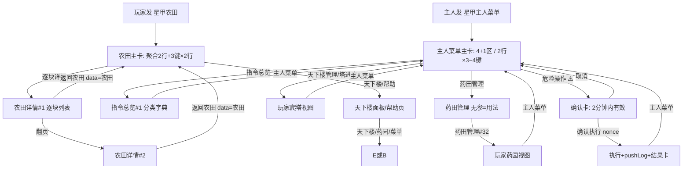

# 星甲面板 v2 · QQ 卡片体验设计规范（Phase 2）

> 消费方：Phase 3 工程（fe-engineer）。上游：`QQ卡片视觉规范-Phase1.md`（视觉重量阶梯 / 窄屏计宽 / 长列表 / 按钮 / 倒金字塔 / 管理基调），本规范在其之上锁定**信息架构与交互闭环**，不推翻任何 Phase 1 约束。
> 载体：QQ 官方 Markdown + 按钮行；手机 QQ 375～430px；二级页 = **另一条独立指令回复**（QQ 卡片无折叠、无路由栈，"返回"= 发一条父级指令生成新卡片，旧卡片留在聊天流中，属正常形态）。
> 本文所有"新增指令"均为**薄封装**：复用现有读/写函数与 helper，仅新增路由分支与面板拼装，Phase 3 实现成本见 §3.4。

> **【阅读约定 · 写给 Phase 3】线框里 `> 蓝链：…` 中的「蓝链：」是记号**
> 「蓝链：」只是 Phase 1/2 用来标注"此行由蓝链生成"的**记号，不是给用户看的文字**。实际输出由 `蓝链([[指令, 显示文本], ...])` 生成，QQ 上**只会显示显示文本序列**（如 `查号 · 查玩家 · 排行`），**不含「蓝链：」三字**。所有带此记号的灰行同理（§1.3、§2.1、§3.1）；工程实现时请把「蓝链：」替换为真实蓝链调用。

---

## 0. 读码基线（设计所依据的真实指令现状）

| 现状 | 证据 | 设计结论 |
|---|---|---|
| 主人菜单 6 行按钮，第 6 行必被丢弃 | `admin.mjs:137-148` 6 个 `row()`；`qq.mjs:183` `if(out.length>=5) break` | 主卡按钮压到 **2 行**（≤3 键/行） |
| 半成品参数按钮（点下去填占位符） | `am1 "查看玩家#"`、`am10 "全服公告#内容"`、`viewPlayer` 的 `设置星羽#编号#` | 全部删除；参数类只给**完整示例值**一行 |
| 农田 10 地块 10 行 + 10 条升级蓝链 | `farm.mjs:637-669` | 主板聚合 2 行；明细迁「逐块详情」 |
| 战斗开场 13 行纯文本 + 1 行 5 键 | `tower.mjs:626-644` | 倒金字塔 5 数据行 + 2 按钮行；判定条映射现有 `评估` 逻辑（`tower.mjs:498-501`） |
| 运行状态正文 `##` 与外层标题重复、约 20 行 | `admin.mjs:396-417` | 去 `##`；4 区各 1 行 |
| 已有完整指令参考页可复用 | `menu.mjs:507-545 分组菜单()/完整指令菜单()`，含"👑 主人指令"组 | 「指令总览」复用 `分组菜单()`，只加一张表 + 一条路由 |
| 已有规则/帮助页 | `tower.mjs:560 天下楼帮助`、`herb.mjs:351 药园帮助`、`menu.mjs:126 使用指南` | 帮助页**不新建**，只统一入口命名与返回 |
| `actBtn` 回调不过 `owner` 校验 | `router.mjs:850 onCallback` 无 `isOwner` | **危险操作确认回调必须显式补 `isOwner`**（见 §4.3 高风险） |
| `btn` 自动加"星甲"前缀、`data` 截 90 字符、`label` 截 12 字符 | `qq.mjs:115-140` | data 写中文指令本身即可；示例值控制在 90 字符内 |

---

## 1. 二级页信息架构（入口命名 + 返回闭环）

### 1.1 命名总表（用户看到的文字 → 实际指令 → 返回 data）

| 二级页 | 入口显示文字（蓝链/按钮 label） | 实际指令（data，由 `btn` 自动加"星甲"前缀） | 返回按钮 data | 父卡 |
|---|---|---|---|---|
| 农田逐块详情 | `逐块详情` | `农田详情`（新增）；翻页 `农田详情#页码` | `农田` | 🌾 星甲农田 |
| 管理·指令总览 | `指令总览` | `指令总览`（新增）；翻页 `指令总览#页码` | `主人菜单` | 👑 主人菜单 |
| 管理·药田管理 | `药田管理` | `药田管理`（无参=用法）；`药田管理#编号`（新增） | `主人菜单` | 👑 主人菜单 |
| 管理·天下楼管理 | `天下楼管理` | `塔进度#编号`（新增）；重置复用 `重置天下楼#编号` | `主人菜单` | 👑 主人菜单 |
| 规则/帮助页（已有） | `📖 帮助` / `天下楼帮助` / `药园帮助` / `指南` | `天下楼帮助`（已有）/ `药园帮助`（已有）/ `指南`（已有） | 各自父面板：`天下楼` / `药园` / `菜单` | 对应主面板 |

**闭环规则（三条，Phase 3 逐页核对）：**
1. 每个二级页**最后一行按钮**必含一个返回按钮，data = 父卡指令（见上表），label = `返回农田` / `返回菜单` / `主人菜单`（2～4 字）。
2. 每个二级页**正文首行**用灰行标明来源：`> 来自 <父卡名> · 发 <返回指令> 返回`，与按钮互为冗余（防按钮失效时仍能手打返回）。
3. 分页二级页：翻页按钮与返回按钮**分行**（翻页行只放翻页，返回在末行），避免 5 行被截断；`指令总览` 复用 `分组菜单()` 现成的翻页 + `星甲菜单` 按钮，额外把末行 `星甲菜单` 保留即可（它本身就是返回路径之一），但**必须追加 `主人菜单` 按钮**才能回到管理上下文（见 §3.3）。

> QQ 无折叠：`逐块详情` / `指令总览` 不是"展开"，而是**新消息卡片**。用户点返回会再生成一张父卡，聊天流里会出现"主卡→二级卡→主卡"三条消息 —— 这是预期行为，不做撤回（QQ 撤回有 2 分钟限制且会误伤）。

### 1.2 任务流程图



### 1.3 各二级页正文结构（线框要点）

**① 农田详情（新增，薄封装 `读农场/读农田等级/成熟数/空地数/倒计时`）**
```
标题：🌾 农田逐块详情 1/2
**▍总览**                      ← 灰行，来自主卡聚合数据，≤18格
> 可收 3（1/4/7）· 生长 4 · 空地 3
>
**▍逐块（按号，每页6块）**       ← 一行一语义，状态词进分区
> 1 ✅星芽菜×8 · Lv.3
> 2 🌿12分 · Lv.2
> 3 🟫 · Lv.1
>
**▍升级入口**                   ← 只放本页有地块的号，蓝链复用现有指令
> 1号⬆ · 2号⬆ · 升满1号
>
**▍规则（从主卡迁出）**
> 上限 Lv.10 · 每级产量×2 · 浇水30分/次
> 偏好 星芽菜（收货自动补种）
>
> 来自 农田 · 发 星甲农田 返回     ← 来源冗余行
按钮 row(btn 上一页, btn 下一页) / row(btn 返回农田 data=农田, btn 一键收 data=收获)
```
- 每块 1 行、≤12 格；10 块分 2 页（6+4），满足"列表 ≤12 行"。
- 升级蓝链用 `蓝链([["星甲农田升级#1","1号⬆"],["星甲农田升满#1","升满1号"]])`，**不是** 10 条全列。
- 浇水/偏好规则集中到本页 `▍规则`，主卡不再出现长句。

**② 指令总览（新增，复用 `分组菜单()`）**
```
标题：📖 指令总览 1/N
> 管理指令全集 · 发 星甲指令总览#页码 翻页
**▍玩家数据**
> （此行由 `蓝链(...)` 生成完整指令示例，每模块≤6行，见 §3.3 表；不输出「蓝链」二字）
**▍权限**
...
[复用 分组菜单() 的翻页行]
末行按钮：上一页 / [页码] / 下一页 / 主人菜单
```
- 每页 2 个模块组、每模块 ≤6 行、翻页 ≤3 键 + `主人菜单` 第 4 键（`row()` 上限 5，安全）。
- `分组菜单()` 现成的末行是 `另个菜单/星甲菜单/使用指南/属性` —— 属**玩家上下文**，管理场景需在末尾**追加 `主人菜单`** 按钮（可加第 5 键或单起一行，总行数仍 ≤3）。

**③ 药田管理 / 天下楼管理（新增视图，正文见 §3.3）**

**④ 帮助页（不新建）**：`天下楼帮助` 已有 `th2 天下楼` 返回；`药园帮助` 需补 `返回药园` 按钮（`data=药园`）；`指南` 用 `菜单` 返回。Phase 3 只补按钮，不动正文。

---

## 2. 两处 UI 的逐字段信息架构

### 2.1 农田面板 — 字段级去留表

| 字段（现状 `farm.mjs:630-679`） | 主卡 | 迁往 | 呈现规则 |
|---|---|---|---|
| `## 🌾 我的农田` | ❌删 | 外层 `标题:"🌾 星甲农田"` | 正文禁 `##`（P1） |
| 地块总数 `地块 N 块` | ✅ | — | 并入 `▍地块` 计数行 |
| 熟/生长/空 计数 `✅可收 N · 🌿生长 N · 🟫空地 N` | ✅ | — | `> 可收 **3**（1/4/7）· 生长 4 · 空地 3`（图例进分区名） |
| 可收清单（1/4/7 号 + 作物 ×产量） | ✅ | — | `> ✅ 1号【星芽菜】×8 · 4号【露珠菜】×6`（≤18格） |
| 临近成熟（2号12分…） | ✅ | — | `> 🌿 2号 12分 · 5号 8分 · 8号 21分`（Top3，词已进图例） |
| 10 条逐块等级/状态/产量 | ❌ | **逐块详情** | 每块 1 行 Lv+状态+倒计时/产量，分 2 页 |
| 10 条升级蓝链 | ❌ | **逐块详情** | 主卡只留 `升1号`；详情有本页全部/升满 |
| 地块等级规则（Lv10/每级翻倍） | ❌ | **逐块详情 · ▍规则** | 一行写完 |
| 浇水规则（30分/提前5~10%） | ❌ | **逐块详情 · ▍规则** | 一行写完 |
| 播种偏好（默认菜种/自动补种） | ⚠️条件保留 | **逐块详情 · ▍规则** | 主卡仅在**已设置**时留 `> 偏好 星芽菜（自动补种）`；未设置不占位 |
| 一键收/种满/浇水/升1号 | ✅ | — | 按钮行表达，不写正文长句 |
| 逐块详情入口 | ✅ | — | 仅按钮 1 处（fd3 → `星甲农田详情`，Phase 3 新增指令 §3.4#2）；蓝链行不放，与 Phase 1 §6 修订后模板一致 |
| 买种子/商店/食堂/背包 | ❌ | 菜单 | 主卡砍到 2 行按钮（见下） |

**主卡 After（灰混拼装，正文 8 行：3 分区 + 5 灰行，含 2 分隔）**
```
**▍地块（✅收 🌿长 🟫空）**
> 可收 **3**（1/4/7）· 生长 4 · 空地 3
>
**▍优先处理**
> ✅ 1号【星芽菜】×8 · 4号【露珠菜】×6
> 🌿 2号 12分 · 5号 8分 · 8号 21分
>
**▍升级与操作**
> 升1号 · 农场面板 · 食堂
> 一键收 · 种满 · 💧浇水
```
> 上面两行均为蓝链行：实际由 `蓝链([[星甲农田升满#1,升1号],[星甲农场面板,农场面板],[星甲食堂,食堂]])`、`蓝链([[星甲收获,一键收],…])` 生成，输出**不含「蓝链：」前缀**。此蓝链行与 Phase 1 §6 修订后模板一致。
> 注 1：Phase 1 §6 旧模板里的 `批量升满` 目前**无后端指令**（只有 `农田升满#N` 单块）。Phase 3 **不得**造无支撑入口：主卡蓝链用 `升1号`（`农田升满#1`），全局批量升满本期不做。
> 注 2：**「逐块详情」不走蓝链，走按钮 fd3（`星甲农田详情`）**。该指令在现网 router 中尚不存在，但已作为 **Phase 3 新增指令 #2** 明确定义于 §3.4（正则 + 落点 + 依赖），因此是有后端交付计划的入口，不是无效入口；Phase 3 必须同时实现该指令，否则按钮会失效。此布局与 Phase 1 §6 修订后"按钮含逐块详情"一致。

**主卡按钮（2 行 × 4 键，`kb()` 行数安全）**
```
row(actBtn fd1 一键收 harvest, actBtn fd2 种满 plantall|星芽种子,
    btn fd3 逐块详情 农田详情, btn fd4 浇水 农田浇水)
row(btn fd5 升1号 农田升满#1, btn fd6 农场 农场,
    btn fd7 食堂 做菜, btn fd8 菜单 菜单)
```
- 高频（收/种）在**第 1 行左侧**；`逐块详情` 第 1 行第 3 位，拇指易达。
- 无危险操作，无需末行隔离。

### 2.2 战斗开场 — 判定映射与逐档字段

#### 2.2.1 判定条件 → 三档（直接复用 `tower.mjs:493-501` 的 `预算`）

设 `血=血量上限`、`总=预算.总`（= 血 × 塔内承伤系数）、`瓶=预算.药瓶`（玄元凝血膏600/瓶）、`高瓶=预算.高药瓶`（太虚还魂汤5000/瓶）、`倍=预算.倍数`。

| 档 | 判定条件（Phase 3 直接照抄 `评估` 分支） | 判定条模板（黑行、**无▍**、全卡唯一） |
|---|---|---|
| ☠️ | `总 > 血`（不吃药约死 `预算.死几次` 次） | `**☠️ 会死（血量×倍）· 先备 瓶 瓶凝血膏 / 高瓶 瓶还魂汤，再1档削血**` |
| 🟡 | `0 < 总 ≤ 血` | `**🟡 要吃药 · 先1档削血，备 瓶 瓶凝血膏**` |
| 🟢 | `总 === 0`（1~29 层无煞气） | `**🟢 可以打 · 直接普攻**` |

边界与兜底：
- `瓶=0` 但档为 🟡/☠️ 时**强制显示 1 瓶**（`Math.max(1, 瓶)`），避免"要吃药却不给数量"。
- 三档**必须**在判定条内写"选哪个技能"（🟢普攻 / 🟡·☠️先1档削血），同时用按钮顺序强化（见 2.2.3）——双编码，满足 3 秒自检第 3 问。
- emoji 只用 🟢/🟡/☠️ 三选一，判定条**不叠加** ✅/🟢 双标（Phase 1 §2.2）。

#### 2.2.2 每档正文保留行（倒金字塔，固定顺序，可省列已标注）

| 顺序 | 内容 | 语法 | 🟢 | 🟡 | ☠️ |
|---|---|---|---|---|---|
| 1 | 判定条 | 黑，无▍ | ✅ | ✅ | ✅ |
| 2 | 敌核心：`敌 **名** 血 **kfmt(怪.血)** · 防 怪.防` | 灰 | ✅ | ✅ | ✅ |
| 3 | 我核心：`你血 **起手血/血上限** · 蓝 起蓝/蓝顶 · 技能点 1` | 灰 | ✅ | ✅ | ✅ |
| 4 | `▍对位` + `攻 你 **攻** / 敌 怪.攻 · 暴击 怪.暴伤%` | 黑+灰 | ✅ | ✅ | ✅ |
| 5 | `▍风险` + `⚠️ 敌暴击约 **kfmt(攻×暴伤%)**` | 黑+灰 | ❌整段删 | ✅ | ✅ |

- **数据行 ≤5、分区标题 ≤2、分隔 ≤2，正文渲染总行 ≤9**（🟢 场景 ≤6）。超过即违反 P1。
- **一律删除**（移 `📖 帮助` 与 `天下楼面板()`）：`战斗开始！`、层数独立行、固定数值说明、段位×系数、暴击推导、预计药费、通关星羽/经验、回合上限、无入场费/无冷却、公式、"回复 请决定下一步操作"。
- `总承伤 血量×倍` **仅在 ☠️ 档**放风险行（`⚠️ 敌暴击约 X · 总承伤 血量×2.4`），🟡 档风险行只写暴击威胁；🟢 档无 `▍风险`。

**After 三档样例（🟡，灰混拼装）**
```
**🟡 要吃药 · 先1档削血，备凝血膏 3 瓶**
> 敌 **霜甲卫** 血 **12.3万** · 防 700
> 你血 **8.6万/8.6万** · 蓝 100/100 · 技能点 1
>
**▍对位**
> 攻 你 **3200** / 敌 2800 · 暴击 100%
>
**▍风险**
> ⚠️ 敌暴击约 **2800** · 脆皮可能被秒
```
（☠️：判定条换 ☠️ 模板、风险行追加 `· 总承伤 血量×2.4`；🟢：删 `▍风险` 段、判定条换 `**🟢 可以打 · 直接普攻**`。）

#### 2.2.3 按钮（2 行，技能建议冗余表达）
```
row(actBtn cb1 普攻 ba|atk, actBtn cb2 1档 ba|skill|1,
    actBtn cb3 2档 ba|skill|2, actBtn cb4 治疗 ba|heal)
row(btn cb5 一键10 autoatk|10, btn cb6 详情 天下楼,
    btn cb7 ⚠逃跑 ba|flee)
```
- **按钮顺序即技能建议**：🟢 第 1 键=普攻；🟡/☠️ 第 1 键=`1档`（把 `1档` 与 `普攻` 对调即可，data 不变），与判定条文案一致。
- `⚠逃跑` 高危操作在**末行末位**；`1档/2档` 标签不带倍率（倍率是规则信息，进帮助）。
- style 只用 1（回调主操作）/0（导航）；未真机验证的 2~4 一律不用。

---

## 3. 管理界面模块划分

### 3.1 主人菜单主卡（4 核心区 + 1 玩法管理区，≤10 **有效行**，不含分隔空行）

```
**▍玩家**
> 查号 · 查玩家 · 排行
> 参数写全值，例 `发放道具#32#星羽#9999`
>
**▍权限**
> 主人列表 · 封禁名单 · 查我行
>
**▍系统**
> 运行状态 · 插件统计 · 管理日志
> `软重启`（清缓存）· `重载插件`（热重载）— 均需二次确认
>
**▍群务**
> 群管 · 本群信息 · 入群欢迎
>
**▍玩法管理**
> 药田管理 · 天下楼管理 · 指令总览
```
- 5 分区（Phase 1 的 4 区 + 本期按用户需求新增"玩法管理"，仍满足 ≤6 分区上限）。本卡为 **7 有效行 + 4 分隔 = 16 物理行**，按 Phase 1 口径有效行 ≤10，合规。
- **每行 ≤3 蓝链**；`指令总览` **只在玩法管理区出现一次**（玩家区已删，避免同卡重复），按钮行 am5 另作快捷入口不算蓝链重复。
- 所有链接行均由 `蓝链([[指令,显示文本],...])` 生成，实际输出**不含「蓝链：」前缀**（见文首阅读约定）。
- **参数类只有完整示例值**（`发放道具#32#星羽#9999`），无 `#内容`/`#编号` 半成品。
- 按钮 **2 行 × 3~4 键**（替代现状 6 行）：
```
row(btn am1 查号 查号, btn am2 状态 运行状态,
    btn am3 日志 管理日志, btn am4 玩法管理 药田管理)
row(btn am5 指令总览 指令总览, btn am6 群管 群管,
    btn am7 菜单 菜单)
```
- 危险操作（软重启/重载/封禁/重置）**不进按钮行**，只在正文给完整指令 + 二次确认流程（§4.3），从根上避免误触 —— 这也符合 Phase 1 §5.4"危险操作独立分区/末行"。

### 3.2 二级模块清单与内容（含"复用"vs"新增"判定）

| 模块 | 显示内容（字段级） | 提供操作 | 指令 | 复用/新增 |
|---|---|---|---|---|
| 玩家资料 | 沿用 `属性面板()` 黑灰混排，不另写纯文本 | 查/改值 | `查看玩家#编号`、`设置<字段>#编号#值`、`发放道具#编号#名#数量` | **复用** |
| 权限 | 最高权限者 + 主人列表 + 封禁名单 + 查我行 | 加/删主人、封/解封 | `主人列表`、`封禁名单`、`加主人#openid`、`删主人#openid`、`封禁玩家#编号`、`解封玩家#编号` | **复用** |
| 系统运行 | 4 区各 1 行（进程/全服/存储/环境），去 `##`，正常不加 emoji，CPU>80%/内存>80% 才行首 🔴 | 刷新/统计/日志/软重启/重载 | `运行状态`、`插件统计`、`管理日志#页码`、`软重启`、`重载插件` | **复用**（仅重排面板） |
| 管理日志 | 每页 **10 条**（现 20→10），每条 `> 3. 13:42 改星羽#32（主人A）` ≤18格 | 翻页/刷新/返回 | `管理日志#页码` | **复用**（改分页常量） |
| 群管 | 现有群管帮助 6 板块，不重做 | 基础群管/入群验证/撤回/违禁/运营/审核 | `群管` 及其子指令 | **复用** |
| 指令总览 | 按分类的完整管理指令字典，见 §3.3 | 查阅 + 点蓝链直接填指令 | `指令总览#页码` | **新增**（薄封装 `分组菜单()`） |
| 药田管理 | 见下方 ① | 查看玩家药园 + 改田等级/开垦数 | `药田管理#编号`（新增视图）、`药田改田#编号#田号#等级`（新增）、`药田开垦#编号#数量`（新增） | **新增 3 条薄指令** |
| 天下楼管理 | 见下方 ② | 查看玩家爬塔进度 + 重置 | `塔进度#编号`（新增视图）、`重置天下楼#编号`（**复用**已有，走二次确认） | **新增 1 条视图指令** |

#### ① 药田管理（查看/调整玩家药园）

**视图正文（`药田管理#32`，复用 `读药园(ctx,u)`、`读种子仓`、`园日上限`；编号→openid 用现有 `byGid`）**
```
**▍玩家**
> 编号 **32** · 昵称 张三 · 开垦 **6**/8 块
>
**▍田块**
> 等级 4/4/3/2/1/1 · 均级 2.5 · 上限 Lv.10
> 种植 2（可收1·生长1）· 空 4
>
**▍炼药 / 药柜**
> 炼药 Lv.**5**（经验 120）· 日上限 8000 血
> 药材 凝露草×12 · 成药 凝露散×3
>
**▍调整**（完整示例，参数写全）
> `药田改田#32#1#5` · `药田开垦#32#7`
>
> 来自 主人菜单 · 发 星甲主人菜单 返回
按钮 row(btn 返回 主人菜单, btn 玩家资料 查看玩家#32)
```
- 田等级数组**只显示已开垦块**（`开垦` 之后的 0 不列），避免 8 个数字刷屏；数字半角按 0.5 格计，`4/4/3/2/1/1` = 6 格。
- 不展示逐块状态的倒计时（管理场景不需要，且超宽）；需要细看让主人发 `星甲药园`（在自己视角）或控制台。

**新增指令（用途 + 参数格式 + 复用点）**
| 指令 | 参数格式 | 用途 | 实现复用 |
|---|---|---|---|
| `星甲药田管理` / `星甲药田管理#<编号>` | `<编号>`=玩家数字编号（`byGid` 反查 openid） | 无参→用法提示+示例；有参→上面视图 | 读药园/读种子仓/园日上限/byGid |
| `星甲药田改田#<编号>#<田号>#<等级>` | 田号 1~8、等级 1~10；越界 `夹紧字段` 风格裁剪 | 直接设置某块田等级（管理员调节，不扣费） | 读药园→改 `田等级[田号-1]`→`写药园`→`pushLog` |
| `星甲药田开垦#<编号>#<数量>` | 数量 1~8 | 直接设置已开垦块数（不扣星羽） | 同上，改 `开垦`→`写药园`→`pushLog` |

> 范围边界：**不新增**药柜/种子仓/偏好/炼药等级的写入指令（避免"造一堆后端"）；这些通过控制台或让玩家自己操作。若后续确需，另立需求。

#### ② 天下楼管理（查看/重置爬塔进度）

**视图正文（`塔进度#32`，复用 `天下楼记录`、`天下楼怪`、`天下楼推荐等级`）**
```
**▍玩家**
> 编号 **32** · 张三 · 推荐 Lv.36
>
**▍爬塔进度**
> 当前 **第 12 层** · 最高 **15** · 通关 **9** 次
>
**▍下一层预览**
> 第 12 层 霜甲卫 · 血 **12.3万** · 防 700 · 推荐 Lv.36
>
**▍操作**（危险，需二次确认）
> `星甲重置天下楼#32`（不可撤销 · 归零为第1层）
>
> 来自 主人菜单 · 发 星甲主人菜单 返回
按钮 row(btn 返回 主人菜单, btn 玩家资料 查看玩家#32)
```
**新增指令（1 条视图）**
| 指令 | 参数格式 | 用途 | 实现复用 |
|---|---|---|---|
| `星甲塔进度#<编号>` | `<编号>`=玩家数字编号（`找玩家键` 兜底 openid，与 `重置天下楼` 同口径） | 查看该玩家层/最高/通关 + 下一层预览 | 天下楼记录 / 天下楼怪 / 天下楼推荐等级 |

- 重置**复用**已有 `重置天下楼#编号`（`router.mjs:94`、`tower.mjs:649`），**不新增**，但按 §4.3 加二次确认。

### 3.3 指令总览的分类字典（内容源）

新增 `主人指令总览组`（放 `menu.mjs`，结构同 `完整菜单组`：`{组, 条:[[指令,说明]]}`），调 `分组菜单(ctx,t,ev,主人指令总览组,"指令总览","📖",2,"指令总览",页)`。每模块 ≤6 行：

| 分类 | 条目（指令 → 说明，示例值写全） |
|---|---|
| ▍玩家数据 | `查看玩家#32` 查档案 · `设置星羽#32#9999` 改值（字段同 `字段表`）· `发放道具#32#星羽#9999` 发放/扣除 · `改编号#旧#新` · `称号#32#名` |
| ▍权限 | `加主人#openid` · `删主人#openid` · `主人列表` · `封禁玩家#32` · `解封玩家#32` · `封禁名单` · `查我行` |
| ▍系统运维 | `运行状态` · `插件统计` · `管理日志#1` · `软重启` · `重载插件` · `全服公告#内容` · `重置每日任务#32`（无参=全服） |
| ▍群务 | `群管` · `本群信息` · `入群欢迎` · `撤回上一条` · `撤回#消息ID` |
| ▍玩法管理 | `药田管理#32` · `药田改田#32#1#5` · `药田开垦#32#7` · `塔进度#32` · `重置天下楼#32` |
| ▍危险操作 | `重置玩家#32` · `封禁玩家#32` · `软重启` · `重载插件` —— 统一二次确认（§4.3），单独一组不与其他混排 |

- 玩家可见的 `完整指令菜单` 继续独立存在，**不合并**（它服务玩家查阅场景）。`指令总览` 只服务主人，含新增管理指令。
- 每条 `条[0]` 就是可点蓝链原文（`分组菜单()` 用 `蓝字原文(c[0], ...)`），点一下填进输入框 —— 天然是"完整示例"，不是半成品。

### 3.4 新增指令实现清单（Phase 3 直接落地，共 6 条路由分支）

| # | 指令/正则 | 落点文件 | 依赖（已存在，无需新后端） |
|---|---|---|---|
| 1 | `^指令总览\s*#?\s*([0-9]{1,2})?$` / `^指令总览$` | `router.mjs` + `menu.mjs`（新组表） | `分组菜单()` |
| 2 | `^农田详情\s*#?\s*([0-9]{1,2})?$` / `^农田详情$` | `router.mjs` + `farm.mjs`（新拼装函数） | `读农场/读农田等级/成熟数/空地数/倒计时` |
| 3 | `^药田管理\s*#?\s*([0-9]{1,9})?$` | `router.mjs` + `admin.mjs`（新视图函数） | `读药园/读种子仓/园日上限/byGid` |
| 4 | `^药田改田#([0-9]{1,9})#([1-8])#([0-9]{1,2})$` | `router.mjs` + `admin.mjs` | `读药园/写药园/pushLog`（夹紧 1~10） |
| 5 | `^药田开垦#([0-9]{1,9})#([1-8])$` | `router.mjs` + `admin.mjs` | 同上（夹紧 1~8） |
| 6 | `^塔进度#([0-9]{1,9})$` | `router.mjs` + `admin.mjs`（新视图函数） | `天下楼记录/天下楼怪/天下楼推荐等级/找玩家键` |

> 全部为**面板 + 参数夹紧 + 日志**，无新玩法逻辑、无新存档结构。重置类复用既有分支，不在此表。

---

## 4. 移动端交互方案

### 4.1 折叠/展开 → 二级页替代

| 需求 | QQ 现实 | 方案 |
|---|---|---|
| 长列表折叠 | 卡片无折叠/手风琴 | 主卡只给聚合 + Top3，「全部」用**二级页新卡**（`农田详情`） |
| 规则/公式折叠 | 无 `<details>` | 全部进帮助页（`天下楼帮助`/`药园帮助`/`指南`），主卡留 `📖 帮助` 蓝链 |
| 指令字典折叠 | 无滚动区 | `指令总览#页码` 分页，每页 2 模块 |
| 参数输入折叠 | 按钮只能填完整串 | 参数类只给完整示例一行（用户复制改数字），**不放半成品按钮** |

### 4.2 拇指区布局与返回路径

- **行位语义**：第 1 行 = 最高频（收/种/普攻/查号），靠左；第 2 行 = 次级导航（详情/状态/日志）；危险操作**末行末位**（`⚠逃跑`、`⚠️重置`）。
- **4 键/行**（约 78px/键）为默认，关键决策行 **3 键**（约 105px）；**禁止 5 键/行**（4 字标签被压到 ~60px，误触率高）。
- **每卡 ≤3 行**（`kb()` 硬 5 行，第 4 行起视觉成"按钮墙"）。主卡与二级页均按此自检。
- **返回一致性**：所有二级页末行末位 = 返回按钮；文案统一 `返回<父>` 或 `主人菜单`；正文首行再写一遍返回指令（冗余，防按钮丢失）。
- 同一卡内 label/data **先去重再排布**（现状 `ownerMenu` 有 3 处 `封禁名单`、2 处 `重置任务`、2 处 `群管` 重复，Phase 3 必须清掉）。

### 4.3 危险操作二次确认（QQ 里怎么做 —— 用"确认卡 + nonce"，不用原生弹窗）

> QQ 无 confirm 弹窗。采用**两段式指令 + 时效 nonce**，且 nonce 不依赖服务端状态（写在按钮 data 里，校验时间戳）。

**流程（以 `重置玩家#32` 为例）**
1. **发起**：危险指令只在正文给完整示例，或放一个 `btn`（type2、style=0、label 前缀 `⚠️`）。点击后**填入输入框由用户再次发送**——这本身是第一道门槛。
2. **确认卡**：路由收到 `重置玩家#32` 后**不执行**，先回一张卡：
```
**⚠️ 确认操作**
> 即将 **重置玩家 32**（养成数值归零），不可撤销。
> 2 分钟内有效。取消请点下方按钮。
按钮 row(btn 取消 主人菜单, btn ⚠️确认重置 "重置玩家确认#32#<nonce>")
```
   - `<nonce>` = 发起时刻 `Date.now()`；`⚠️确认` 放**末行末位**，`取消` 在前。
3. **执行**：路由 `^重置玩家确认#(\d+)#(\d+)$` 校验 `Date.now()-nonce ≤ 120000` 且 `isOwner`，通过才执行 + `pushLog` + 结果卡；过期回"确认已过期，请重新发起"。
4. **取消**：`取消` data = `主人菜单`（或父卡），不写任何状态。

**适用范围**：`重置玩家` / `重置天下楼` / `药田改田` / `药田开垦` / `封禁玩家` / `解封玩家` / `软重启` / `重载插件` / `全服公告` / `重置每日任务` / `撤回`。
**关键安全补丁（Phase 3 必做）**：若用 `actBtn`（type1 回调）做发起键，`onCallback`（`router.mjs:850`）**当前不校验 `isOwner`**，新增的确认/执行回调分支开头**必须** `if(!isOwner(ctx, ses.event)) { 拒绝; return; }`，否则任何人点回调都能执行危险操作。

### 4.4 无障碍（a11y）清单 —— QQ Markdown 语境

> QQ 卡片无 ARIA / 无焦点管理 / 无对比度设置。以下为**等价可读性与可操作性**要求，Phase 3 按此自检。

- [ ] 状态**双编码**（emoji + 文字）：🟢"可以打"、🟡"要吃药"、☠️"会死"、⚠️"确认" —— 色弱/黑白屏用户仅凭文字也能判断，不靠颜色单独表意。
- [ ] 读屏顺序 = 正文自然顺序；**判定条第 1 行** = 最重要信息；不用多列/空格对齐（QQ 不等宽渲染，读屏会乱序）。
- [ ] 每行 1 语义、≤18 格；分隔符统一 ` · `（读屏能自然停顿），不用连续标点/纯符号行。
- [ ] 加粗只标决策数字（≤2 处/行），不整行加粗、不装饰性加粗。
- [ ] 按钮 label 自解释（2~4 字但语义完整：`逐块详情` 而非 `详情X`），**不依赖位置指代**（不写"上面那个"）。
- [ ] 触控目标：4 键/行 ≈78px、3 键/行 ≈105px，均 ≥44px 最小触控标准；危险键独立末行，不与高频键相邻。
- [ ] 返回路径**双重冗余**（按钮 + 正文首行指令），照顾读屏漏听按钮的用户。
- [ ] emoji 全部来自 Phase 1 §2.2 语义表；新增 emoji 先更新表再用。

---

## 5. 验证方案（Phase 3 验收清单）

### 5.1 指令测试矩阵（每条发一次，核对卡片形态）

| 指令 | 预期 |
|---|---|
| `星甲主人菜单` | 正文无 `##`、5 分区、按钮**恰好 2 行**、无重复 label/data、无半成品 `#` |
| `星甲指令总览` / `星甲指令总览#2` | 分页正确、每模块≤6行、末行有 `主人菜单`、点返回回主卡 |
| `星甲农田` | 正文≤8行、10地块聚合为 2 行、升级链接主卡仅 1 条、按钮 2 行×4 |
| `星甲农田详情` / `#2` | 每页 6 块、每块≤12格、`升1号`蓝链可用、返回农田 |
| `星甲天下楼` | 评估前置、帮助页入口存在 |
| `星甲天下楼挑战` → 🟢/🟡/☠️ 三场（1~29层 / 30~60层 / 高层） | 判定条第 1 行、三档文案正确、🟢无风险段、按钮 2 行×4 |
| `星甲药田管理` / `星甲药田管理#32` | 无参出用法；有参 4 区、田等级只列已开垦、返回按钮在 |
| `星甲药田改田#32#1#5` / `星甲药田开垦#32#7` | 生效 + 写日志 + 越界被夹紧（0→1、99→10） |
| `星甲塔进度#32` / `星甲重置天下楼#32` | 视图 4 区；重置走确认卡、nonce 过期拒绝、执行后归零 |
| `星甲运行状态` | 去 `##`、4 区各 1 行、正常无 emoji、CPU/内存>80% 才 🔴、按钮 2 行 |
| `星甲管理日志` | **每页 10 条**、翻页按钮不超 1 行、返回主人菜单 |
| 危险：`重置玩家#32` / `封禁玩家#32` / `软重启` / `全服公告#测试` | 第一步**只出确认卡不执行**、nonce 2 分钟过期、取消回主卡 |

### 5.2 375px / 430px 各看什么

- **375px（最窄）**：逐行核对①每行无折行（≤18格，硬≤22）；②按钮 label 无截断（≤4字）；③4键/行不挤成 60px；④判定条单行显示完整（含"备 N 瓶"）；⑤田等级数字串不折。
- **430px**：核对①18格行不显得空旷（不刻意拉长）；②分区数≤6、正文行数达标；③确认卡 `取消/⚠️确认` 末行末位布局稳定；④分页行 4 键不溢出 5 键上限。
- 两尺寸各对**农田主卡 / 战斗开场🟡 / 主人菜单 / 指令总览 / 确认卡**截 5 张图归档。

### 5.3 战斗开场"3 秒自检"定义（可人工 + 可静态检查）

**人工 3 秒法**：找一名未看过设计的人，给一张战斗开场截图**只看 3 秒**后收回，问 3 个问题：
1. 这一层能不能打？（答出 🟢/🟡/☠️ 之一）
2. 要不要吃药、备多少？（答出"要/不要"+瓶数，🟢 答"不用"）
3. 先点哪个技能？（答出"普攻"或"1档"）
**通过标准：3/3 正确。** 任一题错 → 判定条文案或按钮顺序需重排。

**静态自检（脚本可查）**：
- [ ] 正文第 1 行 = 判定条，且 emoji ∈ {🟢,🟡,☠️}、恰 1 个、无 `▍`；
- [ ] 正文无 `##`、无"战斗开始！/奖励/药费/公式/回合上限/回复 请决定"等折叠词；
- [ ] 数据行 ≤5、分区标题 ≤2（🟢 ≤1）、分隔 ≤2、正文总行 ≤9；
- [ ] 按钮 2 行×4、技能建议与判定条一致（🟡/☠️ 第 1 键=`1档`）、`⚠逃跑` 末位；
- [ ] 三档各造一场（mock `预算`）逐条跑过。

### 5.4 管理 6 行按钮问题回归（专项）

- [ ] `ownerMenu` 传给 `reply()` 的 `行组` 长度 **≤3**（现状 6 → 必改）；`kb()` 硬截 5 行不再触发。
- [ ] 按钮 label/data **零重复**（现状 `封禁名单`×3、`重置任务`×2、`群管`×2 全清）。
- [ ] 无 `查看玩家#`、无 `全服公告#内容`、无 `设置星羽#编号#` 等**半成品按钮**（全卡搜索 `#` 后接中文占位符 = 失败）。
- [ ] `运行状态` 正文首字符不是 `##`；管理日志 `日志每页` 常量 = 10（现 20）。
- [ ] 主卡 + 4 个二级页逐页点"返回"，均能回到 `主人菜单`/`农田` 且聊天流形成闭环（主→二级→主）。
- [ ] 危险指令全流程：发起→确认卡→（过期 / 取消 / 确认执行）三条路径都验证；`actBtn` 新增分支已补 `isOwner`。

---

## 6. Phase 3 提交前总 Checklist

**结构 / 排版**
- [ ] 全部改动面板由 `灰混([...])` 生成；正文无 `##`；标题 ≤14 字；分区以 `▍` 开头、≤6 个、只在分区间插空行
- [ ] 每行 ≤18 格（硬 ≤22）、≤2 处加粗、≤1 个行首 emoji、分隔符 ` · `
- [ ] **每行 ≤3 蓝链**（§2.1 农田、§3.1 主人菜单）；同卡内蓝链入口不重复（如 `指令总览` 只留在玩法管理区）
- [ ] 蓝链行由 `蓝链([[指令,显示文本],...])` 生成，**QQ 输出不含「蓝链：」字样**（文首阅读约定）
- [ ] 管理面板有效行（不含分隔空行）≤10；列表 >6 已聚合；静态规则/公式/图鉴已进帮助页；战斗开场三档折叠词全删

**按钮 / 交互**
- [ ] 每行 ≤4 键、每卡 ≤3 行、label ≤4 字（硬 ≤6）；无半成品参数；label/data 无重复
- [ ] 危险操作末行末位 + `⚠️` + 二次确认（nonce 2 分钟）；`actBtn` 回调补 `isOwner`
- [ ] 二级页 4 个入口命名与返回 data 与 §1.1 表一致；返回双重冗余

**一致 / 兼容**
- [ ] 只复用 `灰混/灰块/蓝字/蓝链/row/btn/actBtn`，无新渲染原语；emoji 来自 Phase 1 §2.2
- [ ] 数值用 `kfmt/倒计时/时长` 等既有函数；新增 6 条指令均为薄封装、无新存档结构
- [ ] 未改既有 14 个面板文案（除本次功能需要）；新旧并排无风格落差
- [ ] 375/430 各 5 张截图归档；战斗 3 秒自检 3/3；6 行按钮回归全通过
